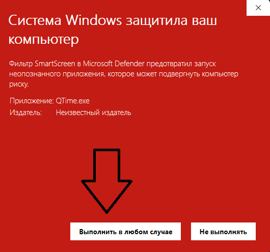
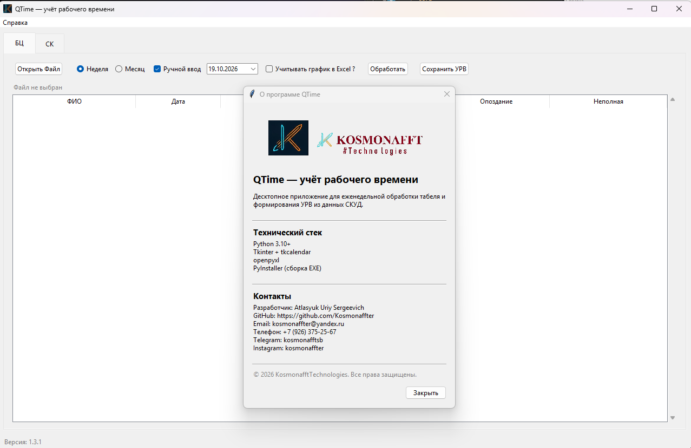
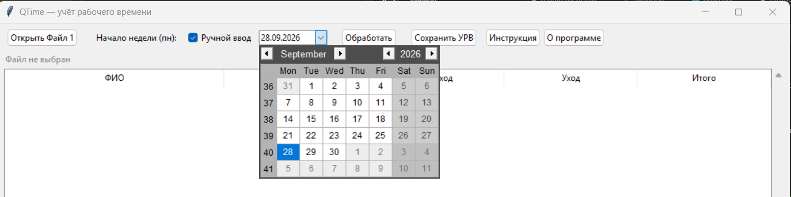
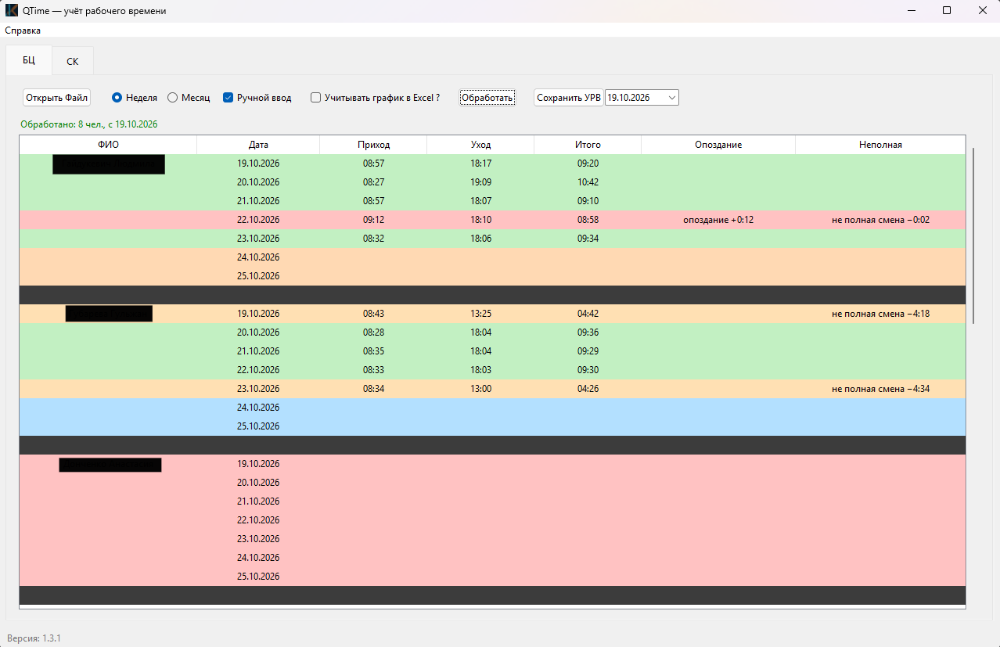
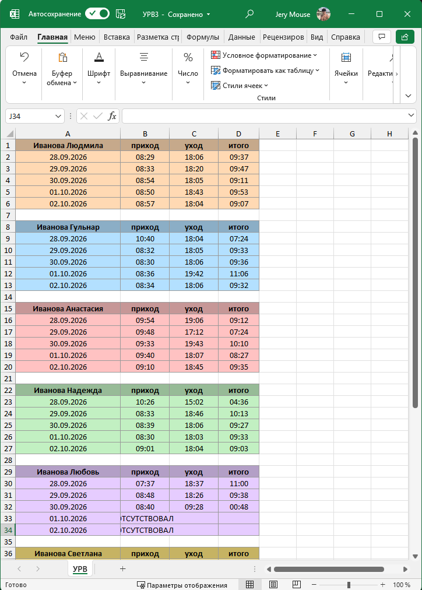
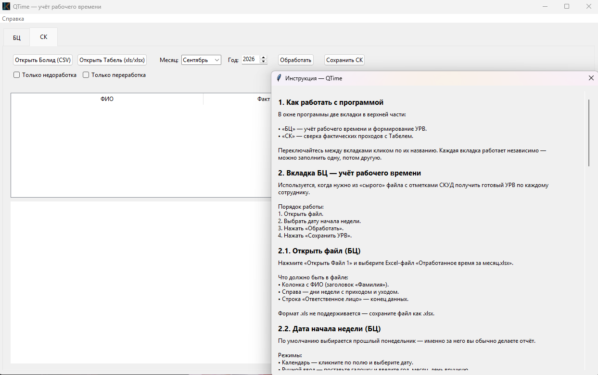
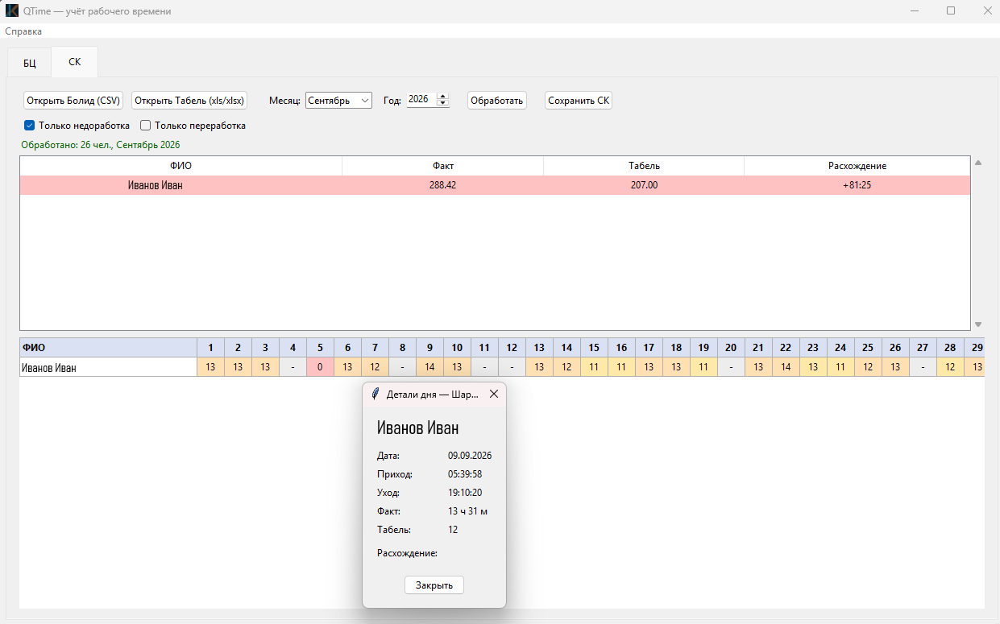

<div align="center">

# QTime

**Десктопное приложение для учёта рабочего времени и сверки с Табелем**


</div>

---

## Содержание

- [О проекте](#о-проекте)
- [Возможности](#возможности)
- [Скриншоты](#скриншоты)
- [Установка](#установка)
- [Запуск](#запуск)
- [Сборка EXE](#сборка-exe)
- [Структура проекта](#структура-проекта)
- [Как это работает](#как-это-работает)
- [Вкладка БЦ — учёт рабочего времени](#вкладка-бц--учёт-рабочего-времени)
- [Вкладка СК — сверка с Табелем](#вкладка-ск--сверка-с-табелем)
- [Шаблоны данных](#шаблоны-данных)
- [Обработка ошибок](#обработка-ошибок)
- [О программе](#о-программе)
- [Лицензия](#лицензия)

<p align="right"><a href="#содержание">↑ к содержанию</a></p>

---

## О проекте

**QTime** — десктопное приложение для автоматизации работы с табелем
рабочего времени. Две независимые вкладки под разные задачи:

- **БЦ** — учёт рабочего времени. Берёт «сырой» Excel-файл с отметками
  Прибытия/Убытия, считает отработанные часы, формирует готовый **УРВ** с
  графиками и опозданиями.
- **СК** — сверка фактических проходов через турникеты (выгрузка
  системы **Болид**) с проставленными данными из **Табеля**. Показывает
  расхождения по каждому дню и итогу месяца.

Приложение рассчитано на кадровиков и руководителей,
которые вручную сверяют данные из Фактического присутствия сотрудников и Табеля.

<p align="right"><a href="#содержание">↑ к содержанию</a></p>

---

## Возможности

### Общие

- Две вкладки в одном окне: **БЦ** и **СК**.
- **Понятные сообщения об ошибках** — без трейсбеков и кодов errno.
- Встроенные окна «О программе» и «Инструкция».

### Вкладка БЦ

- Импорт Excel-файла «Отработанное время за месяц».
- **Гибкий поиск шапки** — программа сама находит строку с заголовком
  «Фамилия» и строку начала данных, независимо от того, где они лежат.
- Выбор даты начала недели: **интерактивный календарь** или ручные поля.
- Автоматический расчёт отработанного времени (`приход` → `уход`).
- Поддержка неполных смен: `нет входа` / `нет выхода` / `ОТСУТСТВОВАЛ`.
- **Графики и опоздания** — для каждого сотрудника задаётся начало
  смены и график (9 или 12 часов). Определяются статусы `опоздание`,
  `не полная смена`, `ОК` с точным отклонением в минутах.
- **Цветовая индикация статусов** в предпросмотре и Excel.
- Экспорт в новый `.xlsx` с границами, заливкой и статусными колонками.
- Каждый сотрудник выделен уникальным контрастным цветом.

### Вкладка СК — сверка с Табелем

- Импорт CSV-выгрузки **СКУД/Болид** (фактические проходы).
- Импорт Excel-**Табеля** (проставленные часы).
- Автоматическая сверка по месяцам: **факт из Болида** против
  **проставленного в Табеле**.
- **Динамический поиск шапки** — программа сама находит раздел
  «Склад», строку «Фамилия» и колонку первого дня месяца. Если
  в Табеле пропущен день — выдаётся понятная ошибка.
- Учёт **обеда (1 час)** — при сравнении к Табелю прибавляется 1 час.
- **Фильтры**: только недоработка / только переработка.
- **Сортировка** обеих таблиц по алфавиту.
- **Canvas-сетка** с покраской каждой ячейки:
  🟢 ОК, 🔴 недоработка, 🟠 переработка, 🟦 нет в Табеле,
  🟪 нет в Болиде, ⬜ нет данных.
- **Закреплённая шапка** с числами дней — не скроллится.
- **Hover** — подсветка ячейки под курсором.
- **Клик по ФИО** в итоговой таблице — подсветка и автоскролл
  строки в сетке дней.
- **Клик по дню** — модалка с деталями: приход, уход, факт, Табель,
  расхождение.
- **Управление показом** — галочки «Показать Болид» и «Показать Табель»:
  - только Болид — дефолт;
  - только Табель;
  - обе — в ячейке `13.5|12.5` (первое — Болид, второе — Табель);
  - обе выкл — пусто.
- **Разные цвета текста** в ячейке: Болид — чёрный, Табель — синий.
- Экспорт **только расхождений** в Excel, с итоговой строкой по
  каждому сотруднику.

<p align="right"><a href="#содержание">↑ к содержанию</a></p>

---

## Скриншоты


### Система Windows — 
1) **SmartScreen** при первом запуске скажет «неопознанное приложение». Нажми «Подробнее» → «Выполнить в любом случае».
2) **Антивирус** может ругаться на EXE без цифровой подписи (она платная, а приложение бесплатное - так что не обращаем внимания).



### Вкладка Меню — учёт рабочего времени



### Выбор даты через календарь



### Готовый УРВ (БЦ)



### Готовый Excel (БЦ)



### Вкладка СК — сверка с Табелем



### Canvas-сетка дней с цветами



<p align="right"><a href="#содержание">↑ к содержанию</a></p>

---

## Установка

### Требования

- Python 3.10+
- Windows 10/11

### Шаги

```bash
git clone https://github.com/Kosmonaffter/QTime.git
cd QTime
python -m venv .venv
.venv\Scripts\activate
pip install -r requirements.txt
```

### `requirements.txt`

```
openpyxl>=3.1.0
xlrd==1.2.0
tkcalendar>=1.6.1
```

<p align="right"><a href="#содержание">↑ к содержанию</a></p>

---

## Запуск

```bash
python main.py
```

<p align="right"><a href="#содержание">↑ к содержанию</a></p>

---

## Сборка EXE

### Вариант 1 — один файл (`--onefile`)
```bash
# Удалить старое

rm -rf build dist QTime.spec
```
```bash
pip install pyinstaller
pyinstaller --noconfirm --clean --onefile --windowed --name QTime --icon assets/qtime.ico --add-data "assets;assets" --hidden-import "babel.numbers" main.py
```

Готовый файл: `dist/QTime.exe`.

### Вариант 2 — папка (`--onedir`)

```bash
pyinstaller --noconfirm --clean QTime-onefile.spec
```

### `build.bat`

```bat
@echo off
chcp 65001 > nul
echo === Сборка QTime ===

python -m venv .venv
call .venv\Scripts\activate

pip install --upgrade pip
pip install -r requirements.txt
pip install pyinstaller

pyinstaller --noconfirm --clean QTime.spec

echo.
echo === Готово: dist\QTime.exe ===
pause
```

### Что нужно знать

- **SmartScreen** при первом запуске скажет «неопознанное приложение».
  Нажми «Подробнее» → «Выполнить в любом случае».
- **`--onefile`** распаковывается во временную папку при каждом
  запуске — первый старт занимает 2–5 секунд.
- **Антивирус** может ругаться на EXE без цифровой подписи.
- **Иконка** кладётся в `assets/qtime.ico` и указывается в `QTime.spec`.

<p align="right"><a href="#содержание">↑ к содержанию</a></p>

---

## Структура проекта

```
QTime/
├── main.py
├── requirements.txt
├── QTime.spec
├── QTime-onefile.spec
├── build.bat
├── README.md
├── LICENSE
├── .gitignore
├── assets/
│   ├── qtime.ico
│   ├── qtime_icon.ico
│   └── logo.png
├── docs/
│   ├── screenshot-main.png
│   ├── screenshot-calendar.png
│   ├── screenshot-result.png
│   ├── screenshot-for_excel.png
│   ├── screenshot-sk-tab.png
│   ├── screenshot-sk-grid.png
│   └── screenshot-sk-dialog.png
├── core/
│   ├── __init__.py
│   ├── constants.py
│   ├── color_utils.py
│   ├── errors.py
│   ├── time_utils.py
│   ├── source_reader.py
│   ├── schedule.py
│   ├── target_writer.py
│   └── sk/
│       ├── __init__.py
│       ├── constants.py
│       ├── bolid_reader.py
│       ├── zup_reader.py
│       ├── comparator.py
│       ├── sk_status.py
│       └── sk_writer.py
└── ui/
    ├── __init__.py
    ├── app_window.py
    ├── sk_canvas.py
    ├── resource_utils.py
    ├── about_dialog.py
    ├── help_dialog.py
    ├── schedule_dialog.py
    ├── tabs/
    │   ├── __init__.py
    │   ├── bc_tab.py
    │   └── sk_tab.py
    └── dialogs/
        ├── __init__.py
        └── day_dialog.py
```

<p align="right"><a href="#содержание">↑ к содержанию</a></p>

---

## Как это работает

Главное окно — `ttk.Notebook` с двумя вкладками. Переключение между
ними мгновенное, состояние каждой сохраняется до закрытия приложения.

**Верхнее меню → Справка** содержит пункты «Инструкция» и
«О программе».

<p align="right"><a href="#содержание">↑ к содержанию</a></p>

---

## Вкладка БЦ — учёт рабочего времени

### Шаги

1. Открываем **Файл 1** — «Отработанное время за месяц».
2. Указываем **дату начала недели** (календарь или ручные поля).
3. Нажимаем **«Обработать»** — данные попадают в таблицу
   предпросмотра.
4. Нажимаем **«Сохранить УРВ»** — получаем новый Excel-файл.

### Логика разбора ячейки

Ячейка одного дня выглядит так:

```
08:58    ← приход
19:00    ← уход
------
8:00     ← игнорируется
```

Берём первые две строки до `------`. Всё, что ниже, не учитывается.

### Если в ячейке одно время

| Ситуация      | Приход         | Уход         |
|---------------|----------------|--------------|
| время < 13:00 | `HH:MM`        | `нет выхода` |
| время ≥ 13:00 | `нет входа`    | `HH:MM`      |
| нет обоих     | `ОТСУТСТВОВАЛ` | —            |

### Пустые сб и вс

Не попадают в итоговый файл — для них строки не создаются.

### Графики и опоздания

Если включить галочку **«Учитывать график и опоздания»** перед
нажатием «Обработать», появится окно настроек:

- **Начало смены** — время в формате `HH:MM`.
- **График** — `9` или `12` часов.

По умолчанию: `09:00`, 9 часов.
```
|              Ситуация             |           Статус        |
|-----------------------------------|-------------------------|
| Приход позже начала смены         | `опоздание +0:15`       |
| Отработано меньше нормы           | `не полная смена −0:30` |
| Приход вовремя и норма отработана | `ОК`                    |
| Переработка                       | не считается            |
```
Оба статуса могут стоять в одной строке.

**Цвета строк:** 🔴 опоздание · 🟠 не полная смена · 🟢 ОК · цвет
сотрудника (нет данных).

<p align="right"><a href="#содержание">↑ к содержанию</a></p>

---

## Вкладка СК — сверка с Табелем

### Шаги

1. **Открыть Болид** — CSV-файл выгрузки проходов.
2. **Открыть Табель** — Excel-табель (`.xls` или `.xlsx`).
3. Выбрать **месяц и год**. По умолчанию — предыдущий месяц.
4. Нажать **«Обработать»** — таблица итогов и Canvas-сетка дней.
5. Нажать **«Сохранить СК»** — Excel с расхождениями.

### Логика сверки

- **Факт** = время от первого входа до последнего выхода из Болида.
- **Табель** = проставленное число часов по колонке дня.
- **Обед** = 1 час. При сравнении `Табель + 1 == Факт`.
- **ОК** — если равенство.
- **Недоработка** (`−HH:MM`) — факт меньше нормы.
- **Переработка** (`+HH:MM`) — факт больше нормы.
- **Итог по месяцу** — тоже с учётом обеда на каждый рабочий день.

### Графики

- `Основной график` → **норма 9 часов** (в Табель ставят 8).
- `Склад X смена (день)` → **норма 12 часов** (в Табель ставят 11).

### Фильтры

- ☐ **Только недоработка** — оставить только сотрудников с
  красными днями.
- ☐ **Только переработка** — оставить только сотрудников с
  оранжевыми днями.

Можно включить оба — тогда остаются сотрудники, у которых есть
любой из типов расхождения.

### Цвета ячеек Canvas-сетки

- 🟢 зелёный — день ОК.
- 🔴 красный — недоработка.
- 🟠 оранжевый — переработка.
- 🟦 голубой — есть в Болиде, нет в Табеле.
- 🟪 сиреневый — есть в Табеле, нет в Болиде.
- ⬜ серый — нет данных ни там, ни там.

**Клик по ячейке** открывает модалку с деталями: дата, приход, уход,
факт, Табель, расхождение (цвет по знаку: красный/оранжевый/зелёный).

### Управление показом чисел

Над сеткой — две галочки:

- **Показать Болид** — по умолчанию **включена**.
- **Показать Табель** — по умолчанию **выключена**.

| Болид | Табель |      Что в ячейке     |
|-------|--------|-----------------------|
|   ☑  |    ☐   | `13.5` (Болид чёрным) |
|   ☐  |    ☑   | `12.5` (Табель синим) |
|   ☑  | ☑      | `13.5\|12.5`          |
|   ☐  | ☐      | пусто                 |
 
### Excel СК

Файл содержит **только расхождения**. Каждый сотрудник — отдельный
блок с итоговой строкой `Общее время работы: Факт | Табель |
Расхождение`.

**Недоработки** выделяются жирным красным шрифтом в колонке
«Расхождение».

<p align="right"><a href="#содержание">↑ к содержанию</a></p>

---

## Шаблоны данных

### БЦ — Файл 1 «Отработанное время за месяц»
```
| A |           B                  |         C     |         D     |    E  | ... |
|---|------------------------------|---------------|---------------|-------|-----|
| № | Фамилия, инициалы, должность | 28 пн         | 29 вт         | 30 ср | ... |
| 1 | Иванова Людмила              | 08:58 / 19:00 | 08:56 / 19:24 | ...   | ... |
```
**Важно:** шапка может быть не в первой строке. Программа ищет
заголовок по слову **«Фамилия»** и стартует данные со следующей
строки. Колонка с датами — сразу справа от ФИО.

### БЦ — Файл 2 УРВ (результат)

**Без графика:**
```
|        A   |    B   |   C   |   D   |
|------------|--------|-------|-------|
| ФИО        | приход | уход  | итого |
| 28.09.2026 | 08:58  | 19:00 | 10:02 |
| 29.09.2026 | 08:56  | 19:24 | 10:28 |
```
**С графиком** — добавляются колонки `статус 1`, `статус 2`:
```
|      A     |    B   |   C   |   D   |          E      |           F           |
|------------|--------|-------|-------|-----------------|-----------------------|
| ФИО        | приход | уход  | итого | статус 1        | статус 2              |
| 28.10.2026 | 09:30  | 18:30 | 09:00 | опоздание +0:30 |                       |
| 29.10.2026 | 09:00  | 17:30 | 08:30 |                 | не полная смена −0:30 |
```
### СК — Файл 1 CSV Болида

Выгрузка «Маршрут ХО или/и посетителей (первый вход и последний
выход)». Разделитель `;`, кодировка **CP1251**.

Пример структуры (урезанный):

```
"дата/время";;;"событие";;;;"дверь";;;"зона доступа";;;"пояснение"
"03.09.2026 05:43:16";;;"Вход";;;;"Служ. вход склад";;;"Склад";;;"..."
"03.09.2026 19:17:54";;;"Выход";;;;"Служ. вход склад";;;"Внешний мир";;;"..."
```

Маркер нового сотрудника — `"фамилия"` в отдельной строке, значение
(фамилия, имя, отчество) — **в следующих строках той же колонки**.

### СК — Файл 2 (табель)

Excel-файл с листами по месяцам: **`Месяц Год`** (`Сентябрь 2026`,
`Август 2026`, ...).

Если на каждом листе — несколько разделов: `Служба Х`,
`Х отдел`, `Склад`. **Программа читает только `Склад`.**

Структура раздела `Склад` (урезанная):
```
|    A      |      B   |        C     |            D        |             E           |     F     |      G    |      H      | ... | O  | P  | Q  | ... |
|-----------|----------|--------------|---------------------|-------------------------|-----------|-----------|-------------|-----|----|----|----|-----|
| Фамилия   | Имя      | Отчество     | Должность           | График работы           | План КОРП | Факт КОРП | Факт Табель | ... | 1  | 2  | 3  | ... |
| Иванов    | Андрей   | Вячеславович | Старший кладовщик   | Склад X смена           | 176       | 176       | 176         | ... |    | 11 | 11 | ... |
| Николаев  | Кахраман | Игнатович    | Водитель погрузчика | Склад X смена           | 172       | 328       | 172         | ... | 11 | 11 | 11 | ... |
```
- **Колонка A** — фамилия. Раздел заканчивается на первой пустой
  строке.
- **Колонка E** — график работы (норма).
- **Колонка O и далее** — часы по дням месяца (1, 2, 3, ...).

<p align="right"><a href="#содержание">↑ к содержанию</a></p>

---

## Обработка ошибок

Все технические исключения превращаются в понятные сообщения.

### Общие
```
|     Ситуация               |                      Что увидит пользователь                                            |
|----------------------------|-----------------------------------------------------------------------------------------|
| Файл открыт в Excel        | «Файл открыт в другой программе (например, Excel). Закройте его и повторите попытку.»   |
| Файл удалён / переименован | «Файл не найден. Возможно, он был перемещён или удалён.»                                |
| Нет прав на чтение         | «Нет доступа к файлу. Проверьте права или закройте его в других программах.»            |
| Не Excel / повреждён       | «Не удалось прочитать файл. Возможно, он повреждён или это не Excel-файл.»              |
| Формат `.xls`              | «Файл в устаревшем формате .xls. Программа работает с современным форматом .xlsx.       | 
                               Откройте файл в Excel и сохраните как «Книга Excel (*.xlsx)»,                           |
                               затем повторите попытку.»                                                               |
| Не удалось сохранить       | «Не удалось сохранить файл. Возможно, он открыт в Excel или нет прав на запись.»        |
```
### БЦ
```
|        Ситуация     |                            Что увидит пользователь                                   |
|---------------------|--------------------------------------------------------------------------------------|
| Нет шапки «Фамилия» | «В файле не найдена строка с заголовком Фамилия. Проверьте, что это тот самый файл.» |
| Нет данных          | «В файле нет данных о сотрудниках.»                                                  |
```
### СК
```
|        Ситуация       |            Что увидит пользователь                                    |
|-----------------------|-----------------------------------------------------------------------|
| Нет листа `Месяц Год` | «Лист `Сентябрь 2026` не найден в файле Табель. Доступные листы: ...» |
| Нет раздела `Склад`   | «Не найден раздел «Склад» в файле Табель»                             |
| Не выбран файл Болида | «Сначала откройте файл Болида»                                        |
| Не выбран файл Табель | «Сначала откройте файл Табель»                                        |
| Нет данных для сверки | «Нет данных для сверки»                                               |
```
<p align="right"><a href="#содержание">↑ к содержанию</a></p>

---

## О программе

**QTime** — внутренний инструмент для автоматизации
формирования УРВ и сверки фактическиого присутствия сотружников с табелем.

### Технический стек

- Python 3.10+
- Tkinter + tkcalendar
- openpyxl + xlrd
- PyInstaller (сборка EXE)

### Разработчик

- **ФИО:** Atlasyuk Uriy Sergeevich
- **GitHub:** [Kosmonaffter](https://github.com/Kosmonaffter)
- **Email:** kosmonaffter@yandex.ru
- **Телефон:** +7 (926) 375-25-67
- **Telegram:** `kosmonafftsb`
- **Instagram:** `kosmonaffter`

© 2026 KosmonafftTechnologies. Все права защищены.

<p align="right"><a href="#содержание">↑ к содержанию</a></p>

---

## Лицензия

MIT. См. [LICENSE](LICENSE).

<p align="right"><a href="#содержание">↑ к содержанию</a></p>